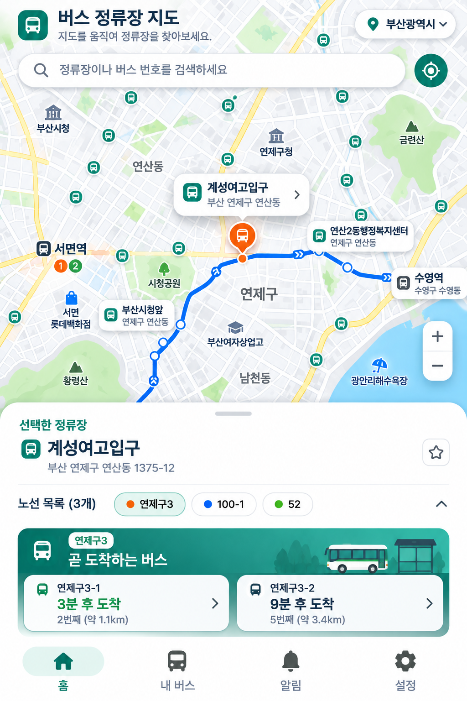

# 버스 정류장 지도 UI 시안 (2026-11-13)

> 기준: 사용자 제공 세로형 지도 스크린샷 `image(9).png` (1024 × 1536). **디자인 참고용**이며 실제 버스 데이터나 구현 완료 화면이 아니다. 이미지 원본을 저장소의 `assets/concept/`에 보관하며 이 문서는 구성 요소와 구현 시 해석 기준을 기록한다.

## 핵심 구성

1. **전면 지도** — 밝은 회백색 건물·도로, 연녹색 공원·산, 연청색 수면. 지도 배경은 충분히 읽히되 주요 버스 정보보다 시각적으로 뒤로 물러나도록 대비를 낮춘다.
2. **상단 헤더** — 왼쪽 청록 버스 아이콘과 ‘버스 정류장 지도’, 안내문 ‘지도를 움직여 정류장을 찾아보세요.’, 오른쪽 현재 선택 지역 칩(예: 부산광역시). 기존 시·구 선택 기능과 연결한다.
3. **검색 영역** — 검색 아이콘이 있는 둥근 흰 검색창(‘정류장이나 버스 번호를 검색하세요’)과 독립된 청록색 현재 위치 버튼.
4. **정류장 마커** — 일반 정류장은 청록색 원형+흰 버스 아이콘, 선택 정류장은 주황색+흰 버스 아이콘. 지도 위에는 정류장명·지역을 보여주는 흰색 라운드 카드/말풍선으로 현재 선택 위치를 보조할 수 있다.
5. **노선 강조** — 선택 노선은 선명한 파란색 경로와 흰색 중심의 정류장 원, 방향 화살표로 표현. 반드시 검증된 실제 노선 형상만 표시하며 정류장을 직선으로 연결해 가짜 길을 만들지 않는다.
6. **지도 조작** — 우측 하단 +/− 확대·축소 버튼을 세로로 배치. 지도 드래그와 핀치·휠 줌도 기존대로 유지한다.
7. **하단 바텀시트** — 흰색의 큰 상단 라운드 패널, 드래그 핸들, ‘선택한 정류장’ 라벨, 정류장명·주소, 즐겨찾기 버튼, 노선 목록 칩과 접기/펼치기 버튼.
8. **도착정보 배너** — 청록 그라데이션의 ‘곧 도착하는 버스’ 배너. 노선별 흰 카드에 버스명, 남은 시간, 순서·거리 등 **실제 제공 데이터에 있는 필드만** 표시한다. 시안의 ‘3분 후’, ‘9분 후’, ‘1.1km’ 같은 값은 예시다.
9. **하단 네비게이션** — 홈 / 내 버스 / 알림 / 설정 4개 아이콘과 이름, 활성 메뉴는 청록색 배경/아이콘으로 강조한다.

## 상호작용 기준

- 지도 빈 공간을 탭하면 바텀시트를 내려 지도 탐색을 우선한다.
- 정류장 마커를 탭하면 해당 정류장을 선택하고 바텀시트를 다시 올린다.
- 검색은 정류장 이름과 버스 번호 검색을 제공하되, 실제로 검색 가능한 데이터와 결과를 구분한다.
- 선택 정류장과 경로는 지도에서 강조하되, 현재 GPS 위치·실시간 차량 위치·도착 예측을 임의로 만들어 표시하지 않는다.
- 상단 지역 칩은 위치 권한으로 추정한 주소가 아니라 사용자가 선택한 탐색 지역을 표현한다.

## 기존 디자인과의 관계

- 이 시안은 기존 **1번 지도 배경 + 4번 정류장 아이콘·노선·하단 배너** 조합을 보다 구체적으로 보여주는 참고 화면이다.
- 색상·형태·레이아웃 참고용으로만 사용한다. 화면에 표시된 서면역·계성여고입구·연제구3 등은 실운영 데이터 검증 대상이다.
- 별도 구현 요청이 있기 전에는 `lib/`, `assets/map/`, 서버 API, DB 및 빌드 설정을 수정하지 않는다.
- 구현 관련 현재 기준은 [대중교통 중심 지도 설계](../../docs/TRANSIT_MAP_IMPLEMENTATION.md)를 따른다.

## 시안 원본 관리

- 첨부 이미지 원본 파일명: `image(9).png`
- 원본 크기: `1024 × 1536`
- 저장소 이미지 경로: [`assets/concept/bus-map-design-2026-11-13.png`](bus-map-design-2026-11-13.png)
- 원본 이미지와 디자인 해설 문서를 함께 관리한다.
